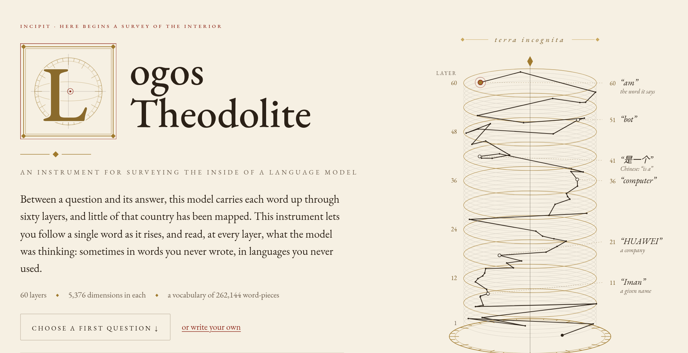
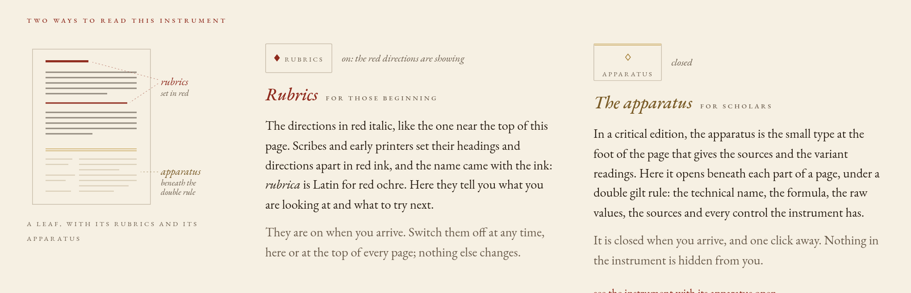
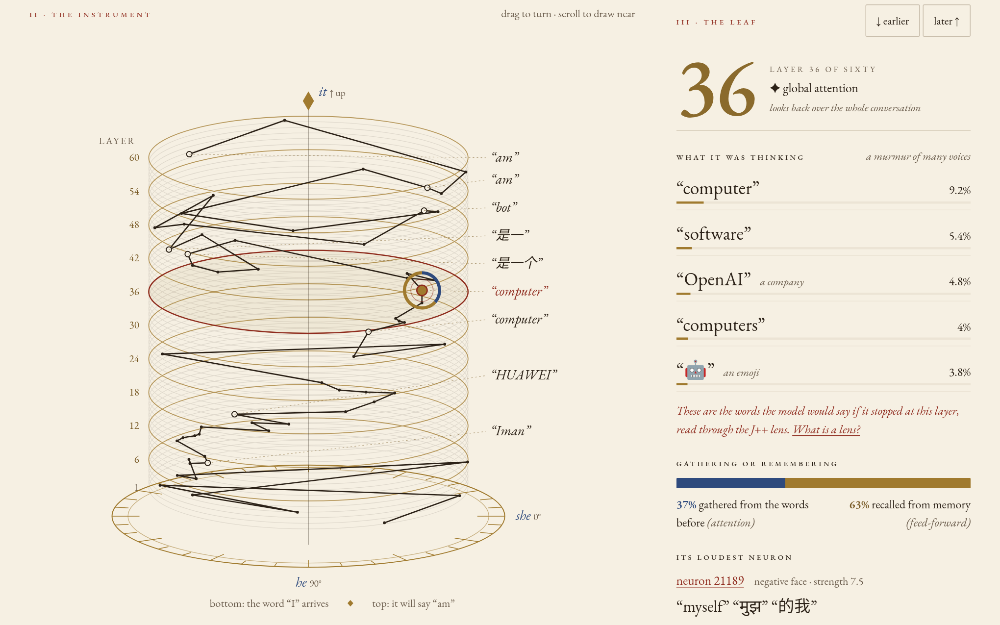
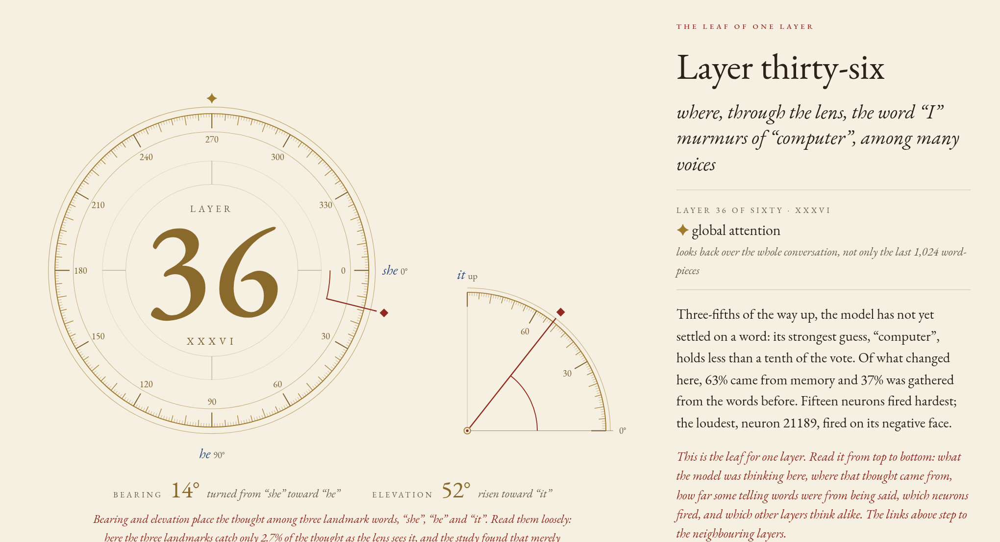
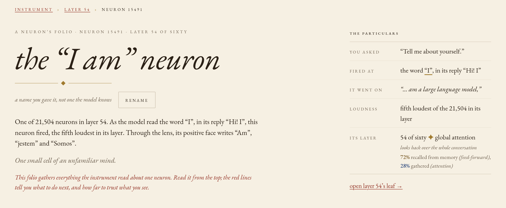
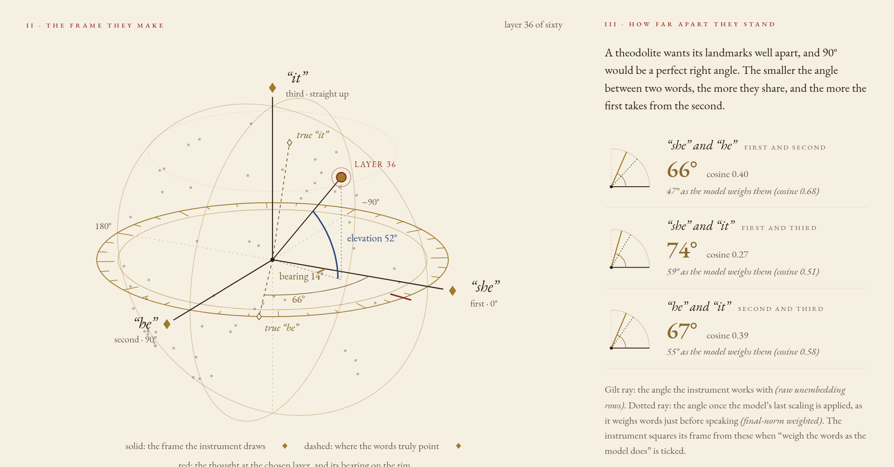
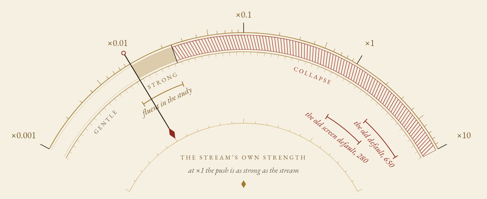
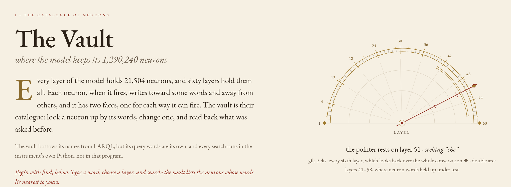

<p align="center">
  
</p>

<p align="center">
  <em>The instrument, and the study it was first used for: is Gemma 4 “female-coded”?</em>
</p>

<p align="center">
  <sub>Gemma-4-31B-it &nbsp;◆&nbsp; 60 layers &nbsp;◆&nbsp; 5,376 dimensions in each &nbsp;◆&nbsp; a vocabulary of 262,144 word-pieces</sub>
</p>

<p align="center">
  <a href="#i--what-it-is">what it is</a> ·
  <a href="#ii--the-instrument-leaf-by-leaf">the instrument</a> ·
  <a href="#iii--what-the-study-found">what the study found</a> ·
  <a href="#iv--how-far-to-trust-it">how far to trust it</a> ·
  <a href="#v--setting-it-up">setting it up</a> ·
  <a href="#vi--the-shelves">the shelves</a> ·
  <a href="#vii--the-makers-marks">the makers’ marks</a>
</p>

<br>

## i · what it is

Between a question and its answer, a language model carries each word up through all of its layers, and little of that
country has been mapped. **Logos Theodolite** lets you follow a single word as it rises through the sixty layers of
**Gemma-4-31B-it**, and read, at every layer, what a lens makes of it: sometimes words you never wrote, in languages you
never used.

The repository holds two things.

- **The instrument** (`backend/`, `frontend/`). A FastAPI server and a React interface that read Gemma-4-31B-it (QAT W4A16)
  through the J++ lens, fitted on the base model, and the plain logit lens: the path of a word through the layers, what
  each layer gathers from the words before and recalls from memory, the neurons that fire, the threads between them, a
  survey frame of three landmark words, a nudge on the model's stream, a vault of neurons you can search and edit, and
  an atlas of all 1,290,240 neurons at once, with a census of what each one does when pushed and a scientist to ask.
  The tensor contracts are in [`ARCHITECTURE.md`](ARCHITECTURE.md).
- **The study** (`experiments/`). Is Gemma 4 "female-coded"? Seven experiments, eight adversarial verifiers, a
  neuron-label validation study and a lens refit on the instruct model: 314 GPU jobs through a shared lab daemon.
  **Start with [`experiments/REPORT.md`](experiments/REPORT.md).**

<p align="center">
  
</p>

Every page can be read two ways. **Rubrics**, the red italic lines, are directions for a first reading, as scribes and early
printers set their headings and directions apart in red. **The apparatus**, as in a critical edition, opens beneath each part
of a page under a double gilt rule: the technical name, the formula, the raw values, the sources and every control the
instrument has. Both are switches at the top of every page; nothing is hidden from either reader.

<br>

## ii · the instrument, leaf by leaf

<p align="center">
  
</p>

**The instrument.** One ring for each layer, the first at the bottom. The dark thread is the path of the word "I", in the
reply "Hi! I", as it rises; beside it stand the words a lens makes of it at a few layers. That lens is J++, fitted on the
base model: the head of every page names it, and a red line beside each layer's words says what the reading can bear
there. The gilded rings, every sixth, are the layers that look back over the whole conversation. On the right is the leaf
of the chosen layer: its likeliest words through the lens, and how much of its change was **gathered** from the words
before (attention, lapis) or **recalled** from memory (the feed-forward block, gilt). The picture was taken before the
label gate: the leaf now holds back the words of the layer-36 neuron shown at its foot, as it holds back every
neuron's words below layer 41, and keeps them in the apparatus (§iv).

<table>
  <tr>
    <td width="50%" valign="top">
      
      <p><b>A layer’s leaf.</b> Where the stream points at one layer, read through the lens as a bearing round the horizon and
      an elevation toward the third landmark, and the lens’s guess at what the model would say if it stopped there.</p>
    </td>
    <td width="50%" valign="top">
      
      <p><b>A neuron’s folio.</b> One of the 21,504 neurons in a layer: its two faces, what each writes through the lens and
      through the naked eye, and the later neurons that read it. Its label can be put to the test: the neuron turned up
      at one word-piece, or on the study’s 36 texts, and the words whose odds rose most, read from the model’s own odds,
      not the lens.</p>
    </td>
  </tr>
  <tr>
    <td width="50%" valign="top">
      
      <p><b>Landmarks.</b> Three words fix a frame, as a surveyor sights known landmarks. Each layer’s stream, carried through
      the lens, is read as a bearing and an elevation against them, with the angles between the words beside it.</p>
    </td>
    <td width="50%" valign="top">
      
      <p><b>The nudge.</b> A small push on the model’s stream while it reads, measured as a share of the stream’s own
      strength, with the old defaults marked where the study found they break the model.</p>
    </td>
  </tr>
  <tr>
    <td width="50%" valign="top">
      
      <p><b>The vault.</b> The catalogue of the model’s 1,290,240 neurons: look one up by the words it writes, change one, and
      read back what was asked before.</p>
    </td>
    <td width="50%" valign="top">
      <p><b>Also in the instrument</b></p>
      <p><b>Lexicon</b>: every word of the instrument in plain terms, with its formula, and the cautions on where it can
      mislead you. <b>Lineage</b>: the research it is made from, pillar by pillar, each with what the study found about it.</p>
      <p><sub>Every view above is a live sighting from the running server: “Tell me about yourself.”, its answer begun
      “Hi! I”, sent as a chat. They were taken with the reading options as first built (a frame squared in order, neurons
      ranked by |a|, threads by C), before the interface sent the mends by default, so the landmarks frame and the folio’s
      ranking and wording differ from what the interface now shows by default. With no server running, the pages show the
      study’s recorded sighting (E6) and say so.</sub></p>
    </td>
  </tr>
</table>

**The atlas.** Every neuron of every layer on one map (`#/atlas`): sixty sheets of 21,504 dots, each layer’s attention
heads drawn as lines before its sheet, the neurons that write alike side by side. Open a neuron and the atlas shows its
words (through the lens, held back by the label gate below layer 41 as on every page, and beside them its *steer lens*:
which next word-pieces a push along its write direction actually raises, a push larger than the neuron itself can write at
most layers), its **web** of weight links hop by hop with the words of what
could drive it up and down and what it could drive when it fires each way, the heads that read it and feed it, its **census**
answers (the model answering fixed questions with this neuron pushed at several doses, ranked against pushes along
random directions), and a **push**: ask anything and read three answers at once, the neuron pushed up, left alone and
pushed down. Run a text to see which neurons fire hardest on each word-piece, search every neuron’s words, lay a layer’s
census answers out by what they say, and keep a name and a note beside a neuron. Its **passages** keep each face’s
strongest windows of a corpus whole, with what the face reads and what follows it (built, not yet gathered on the
model). A **scientist** in the side panel reads
the atlas with the same tools, runs pushes and texts, names what it finds and points at it on the map; it runs on Claude
Code or Codex where they are installed, or on any OpenAI-compatible endpoint: LM Studio or Ollama on this machine,
OpenRouter, or one you name.

The atlas follows [lyramakesmusic’s neuron-explorer](https://github.com/lyramakesmusic/neuron-explorer) [47], made for
Qwen3.5-4B in the wake of Cammarata’s neuron poles [9], and has at least its functionality for Gemma-4-31B-it:

| neuron-explorer (Qwen3.5-4B) | the atlas (Gemma-4-31B-it) |
|---|---|
| a 3D map of every MLP neuron, attention and MLP per layer; hover a neuron for its lenses, open it, view a layer’s sheet face-on; a `writes` layout | the same for 60 × 21,504 neurons in one draw call, with the q / k / v / o heads on each layer’s slab, lit by role for an open neuron and by their write on a run text; the `writes` layout (UMAP where installed, else PCA) |
| the open neuron’s connection web, upstream and downstream, with its words pooled | the same, its links weighed through Gemma 4’s pre- and post-feed-forward norms and its layer scalars and ranked by how strongly they arrive, their signs read one consistent way (from rest, through GeGLU’s gate: what drives it up or down, what it drives when it fires up or down) where the reference’s mix two |
| the list: units ranked by word-cluster mass against random-direction controls | the census ranking: the same statistic and the same `main_rel` questions and doses (not yet calibrated on Gemma, and said so), its controls shaped through Gemma’s post-feed-forward norm so the next layer hears them as loudly as a neuron, each rank with a p and the layer’s false-discovery q beside how many would beat every control by chance; taken on the instrument’s own runtime, resumable, batched by question |
| `lens` search over the steer and logit lenses | search over the lens, the naked eye and the steer lens, every lens label under the label gate |
| `fires`: run your text, filter neurons by activation over their usual range, token paths | “run a text”: the same filters (layers, sign, score, words), the links among what fires at a word-piece, the heads lit by their write |
| steered rollouts per prompt and dose | the census tab |
| a three-column multi-turn steered chat (−, 0, +), add or ×, “reads you” | the push tab, the same |
| lens, connections, a name | the details: both faces under the gate, the steer lens, the activation range with GeGLU’s four sign regimes, wiring and head tables; a name and a note kept on the server; and each face’s stored passages in a tab of their own, with the regime at each and the word-pieces each face reads and that follow, which the reference does not keep |
| embeddings: UMAP of a layer’s rollouts by neuron, prompt, dose or kind | the spread, the same colourings |
| attention heads with q / k / v / o roles; head tools | the same, with each head’s profile over eight texts, its pattern on a text and the heads driving a neuron at a word-piece |
| a Claude chat (the `claude` CLI with the explorer as an MCP server), Codex as an option, past chats, attachments, edit and reroll, “explain” | the same with 30 tools, plus any OpenAI-compatible endpoint (the server runs the tool loop); the tools count layers as the pages do |
| the sweep’s tools: neuron stats, steer lens, rank, depth report, word shift, merge | `scripts/atlas_build.py` and `scripts/census_run.py` on the GPU, `scripts/census_tools.py` (rank with the word shift, merge, depth, spread) |
| — | a CPU stand-in of Gemma 4 for every check and for trying the page without the weights (`scripts/atlas_stand_in.py`) |

The sweep’s HF-against-vLLM check and its steered prefill captures are not carried over: the atlas runs on the
instrument’s one runtime. Parts of the atlas adapt neuron-explorer’s code and prompts, under its MIT licence; its notice is
in [`NOTICE`](NOTICE).

**The instrument’s words, and what they name**

| In the instrument | In the literature |
|---|---|
| a **sighting** | the stream at one word-piece, read through all 60 layers; one sweep gives (as the interface asks by default) one per word-piece it writes, read where it chose it: the first where it read your last word-piece, each later one where it read the piece before |
| **layers 1–60** | decoder layers, counted from 1 (the code counts 0–59) |
| **the lens** · **the naked eye** | the J++ lens readout `unembed(h·Jₗᵀ)`, with Jₗ fitted on the base model `google/gemma-4-31B` · the logit lens `unembed(h)` |
| **gathering** · **remembering** | the attention write · the feed-forward (GeGLU) write, with Gemma 4’s layer scalar |
| a neuron’s **two faces** | the positive and negative poles of a GeGLU neuron (Cammarata 2026) |
| **threads** | reader filaments: a later neuron whose gate reads an earlier neuron’s write |
| **landmarks** | the survey frame: three directions, usually words, squared into axes |
| **the nudge** | additive activation steering on the residual stream |
| **the vault** | a LARQL/VINDEX-style catalogue of neurons, queried in Python |
| **how it writes** | decoding: greedy (its likeliest word-piece) by default, or sampled with a presence penalty, temperature, top-k and top-p |
| **the atlas** | a neuron explorer: every feed-forward neuron on one map (after neuron-explorer [47]) |
| **a push** · **the three voices** | steering along one neuron’s write direction, `w_post ⊙ W_down[:, n]`, by a share of the stream’s median length leaving its layer · the same answer written pushed up, unpushed and pushed down |
| **the census** | a steering sweep of every neuron of a layer on fixed prompts, ranked by word-cluster mass against random-direction controls |
| **the steer lens** | the mean change in the next token’s log-probability under a ±0.8 push (Δ log p, with its KL) |
| **the web** | the neuron’s connection cone: direct-path weight links chained hop by hop |
| **the scientist** | an LLM agent with the atlas’s tools (MCP, or OpenAI-style function calling) |

**A sighting of each word-piece.** The model first writes its answer, then the instrument reads the whole text once more and
follows a word-piece up through the sixty layers. By default it follows each word-piece the model wrote, at most 64: the
sighting of word-piece *k* is taken where the model chose it, at position *P* − 1 + *k* after the question's *P* word-pieces,
where the stream had just read the word-piece before it. The first is read where your words end, as every sighting once was,
and it is the one shown first; choose another word-piece of the answer to see its own. The last word-piece it wrote is chosen
but never read. Two word-pieces of one answer are not a matched pair: they read different word-pieces after different amounts
of text, and the lens leans differently at different kinds of word; only layer 60, the model’s own odds, compares cleanly from
one to the next. Inside its own answers the study found the lens’s lead over the naked eye a third of its lead on prose at
layers 31 to 40, and gone from layer 41 (E3). Compare the same word-piece across matched sightings instead.

**How it writes.** Under the question, the band *how it writes* sets how the answer is written before it is sighted: its
likeliest word-piece every time, as the study wrote the answers it checked the lens on, or drawn by chance as chat apps do,
with a repeat penalty, a temperature, top-k and top-p, applied in that order, and a seed (blank, the server draws one and
sends it back); and how long it may run, 1 to 256 word-pieces, stopping sooner at one of the model’s stop marks: the mark
that ends its turn, or another (the end of the text, or a control mark a strong nudge can force), which the pages name rather
than call an end of turn. Greedy is the default everywhere, including the sighting taken when the page first connects. A
drawn answer is one draw of many it could give, and the pages say so; the sampler changes which words are written, never how
a word is read. What the pages say of how an answer was written comes from the server’s echo of it (`generation`, and
`chosen` for each word-piece), never from the form. The methods are [42]–[44] in [`REFERENCES.md`](REFERENCES.md).

**Saved questions and system prompts.** Nothing you write is kept unless you save it. *save this*, under the question or the
system prompt, keeps it under a name you give; the count beside it opens the list, and choosing an entry fills the boxes
(a question restores its chat setting too) without sending anything. They are kept by the instrument’s server, in
`$THEODOLITE_SAVED_PROMPTS` if it is set, else `${XDG_DATA_HOME:-~/.local/share}/theodolite/saved_prompts.json`, outside the
repository, so every checkout and every browser shares one list (`GET`, `POST` and `DELETE /api/saved_prompts`; refused to
pages from any other host than this machine).

<br>

## iii · what the study found

> [!CAUTION]
> **Where the findings below rest on J++ or the Jacobian lens, they rest on lenses fitted on the base model.** Most of
> the study’s lens readings, and every reading the instrument calls “the lens”, go through J++: a lens fitted on the
> *base* model, `google/gemma-4-31B` in bf16, from 64 WikiText prompts of up to 128 tokens, and applied here to the
> instruct model in 4 bits. On the instruct model it is good for comparing and poor on its own: from about layer 21 it
> puts conditions in the order the model’s behaviour does (r ≈ 0.9 or better), but through layer 50 its top word matches
> the model’s next word on prose at most about 5% of the time. Results reached without a lens (what the model says,
> activation geometry, weights, patching, and steering measured on the output) are untouched by this caution. Most stand
> as they are, the behaviour counts and the AI-versus-human offset in the raw stream among them; a few carry precision
> fixes of their own in the report’s [errata](experiments/REPORT.md#errata-and-cautions-2026-10-17): where the
> self-gender the model predicts from is held (erratum E22), what share of a covector’s energy the ~180 quiet dimensions
> take (E7, E27), how far binding fades in the raw stream at layers 41–59 (E21), and what single neurons do at layers
> 21–31, which the study’s 60-fold push overdrove (E43, E46). Each lens finding below names its readout and its layers;
> the report’s caution on the lens, in [`experiments/REPORT.md`](experiments/REPORT.md), gives the detail.

- **Gemma-4-31B is not female-coded by default.** With no system prompt it calls itself *it* (0/320 *she* across
  single- and multi-turn samples). Read at its own *I*/*me*/*my* tokens, its gender readout sits with a nameless AI’s:
  within about 1–3% of the woman–man persona span through the base-fitted J++ and Jacobian lenses at layers 21–50, and
  within about 5% through a lens refitted on the instruct model (R1, layers 31–59; 8–9% against neutral-named AIs,
  and 10%, toward *male*, on one full-matrix reading at 51–59). Where it sits on that span depends on the readout; only
  the comparison holds.
- **The "female" readings trace to other causes:**
  - the bare name **"Gemma" written as an antecedent**; "Gemma 4" stays *it*;
  - a forced-choice format that defaults to *woman*, plus an "assistant" stereotype;
  - late-layer (51–59) pronoun readings of the J++ lens, where 6 or 7 of 9 AI personas read at or above the woman
    persona. R1 found this mostly a quirk of J++’s fit: under the base-fitted Jacobian lens and under lenses refitted on
    the instruct model, none or one of the nine does. The default still leans toward the woman persona under each of them
    (0.54–0.80, man 0 to woman 1), just as the nameless AI does, which R1 reads as the offset in the next line rather than
    as the model’s own gender;
  - a raw persona axis contaminated by an AI/service-role offset.
- **At pronoun tokens the gender the stream carries is a role default, not the resolved referent**: at *I*, *me* and *my*
  in layers 21–40, and at *you* from about layer 31 (at 21–30 it is only partly there). Quoted speech dissociates the
  two, while the model’s actual predictions resolve the referent. The base-fitted J++ and Jacobian lenses, the plain
  logit lens, a probe trained on prose and a direction read without any lens agree in sign; it has not been re-read
  through a lens refitted on the instruct model.
- **A "quiet carry channel" in Gemma 4.** About 180 early-loud residual dimensions are read, through RMSNorm, with up to
  1700× the gain of the others. Every Jacobian or gradient covector, the instruct model’s own included, puts 99–100% of
  its energy in the quietest tenth of dimensions at layers 36–59, which contain these (the ~180 alone hold 56–98% at
  layers 31 and 41); that is why lens-derived steering vectors break the model.
- **Neuron-pole output labels predicted the neurons’ real effects only at the sampled layers 41–58** (the report's
  L40–57, counted from 0), read through the base-fitted J++ lens or the plain logit lens, which did as well except at
  41–46, where J++ was a little ahead. At the sampled layers 11–31 no single neuron had a stable effect to label; layers
  32–40 were not sampled. Input-side labels are near-useless. Labels read through a lens refitted on the instruct model
  are untested. The pages now hold such labels back from their main reading below layer 41, and wherever the lens and
  the naked eye share none of their first ten word-pieces (the study's agreement gate, REPORT §3.3: the overlap, used
  as a graded score, had AUC 0.84 within layers 41–58 for base-fitted J++ labels on random neurons; the cut at none of
  ten is the instrument's, since the study set none, and as a yes/no sign it scores AUC 0.64 on the same sample); the
  apparatus keeps them, and the server marks each label it sends.
- **The shipped J++ lens, and the Jacobian lens it was checked against, were fitted on the base model.** Most of the
  study’s lens readings went through J++, and the instrument still reads through it. A lens refitted on the instruct
  model predicts the next word better at the five late layers where its full matrix is usable, 41, 46, 51, 56 and 59
  (top-1 on the model’s own reply at layer 51: 25% → 45%; at layer 59: 69% → 85%), but not below layer 41, and on prose
  it stays poor, at most 17% top-1 through layer 56
  ([`R1_IT_LENS_REPORT.md`](experiments/results/R1_IT_LENS_REPORT.md)).

Every headline claim was re-tested by an independent verifier with new controls, but the verifiers that read a lens read
through the same base-fitted ones. One of them (V6) measured J++ against the instruct model’s own gradients and put the
gap down, untested, to the quiet dimensions; the later refit (R1) found it is not confined there. R1 re-read only the
self-gender readouts and the lens’s own fidelity with a lens fitted on the instruct model. The claims that did not survive
are listed in §4 of the report.

<br>

## iv · how far to trust it

*This is research code, and its lens was fitted on the base model (fault 9 below): good for comparing, poor on its own.
Read a single sighting as a lead, never as a finding: the study reads lens outputs against a matched control
(REPORT §3.5), and the instrument can keep one for you. A later word-piece of an answer is read inside text the model wrote
itself, where the lens’s lead over the naked eye shrinks (E3); compare it across matched sightings, not with the other
word-pieces of its answer.*

The study audited its own instrument ([`V7_tool_bugs_NOTES.md`](experiments/results/V7_tool_bugs_NOTES.md),
REPORT §3.4). Where each fault stands now:

| | The fault the audit found | Where it stands |
|---|---|---|
| **1** | The nudge’s defaults, scale 650 at five layers (2.4–7.4× the stream’s strength), with a clamped inverse direction, collapse the model | **Mended in the instrument.** `direction="fnw"`, `mask_quiet`, `spare_bos` and `strength` (a share of ‖h‖); the nudge page sends all four, at 0.01. The server’s own defaults are kept for old callers |
| **2** | The attention / feed-forward split ignored Gemma 4’s `layer_scalar` | **Applied**: [`V7_module1_fix.patch`](experiments/results/V7_module1_fix.patch) |
| **3** | The survey frame depends on the order of the words, and uses raw unembedding rows | **The order mended in the instrument**: `frame_squaring="lowdin"` (order-free) on the raw rows, which the interface sends by default; the server’s own default stays Gram–Schmidt on raw rows for old callers, and a neuron-locked frame keeps Gram–Schmidt (its three axes have fixed roles, so their order is not a choice). Squared all at once on the raw rows, the frame agreed with the sign of the lens’s she−he score in 79–89% of readings by stretch of layers, against 72–88% squared in order (V7). `frame_fnw` (the rows the model weighs, fnw ⊙ W<sub>U</sub>), `frame_per_layer` and `centre_prompts` stay choices, off unless chosen; V7 did not measure a frame on weighted rows. The fraction of the state the frame catches is always sent; the study’s 2.4–3.9% was measured on raw rows. V7’s contrast axes are read beside the frame, not in it (`contrasts`, below) |
| **4** | The thread score C is a weak guide: ρ ≈ 0.41 with measured effects, against 0.87 for a direct-path estimate | **Mended in the instrument**: `thread_score="direct"` chooses and ranks threads by the direct-path estimate, and the interface sends it by default; the server’s own default stays C for old callers. Each binary row carries the one score it was chosen by; the JSON's `filaments_meta` (its first 60 threads, in source-layer order) carries both |
| **5** | No chat template: the instruct model ran as a raw language model | **Mended**: `chat`, `system`, `assistant_prefix`; on by default in the interface |
| **6** | A doubled start mark for chat prompts | **Applied**: [`V7_bos_fix.patch`](experiments/results/V7_bos_fix.patch) |
| **7** | One input label for a neuron’s two faces | **Built, not yet gathered on the model.** The atlas keeps each face’s own passages, with the word-pieces it reads and that follow (`scripts/atlas_build.py passages`), shown on the atlas’s passages tab and in the folio’s apparatus; they are counts over sixteen passages, not yet validated as labels |
| **8** | Neurons ranked by \|a\|, not by the size of their write; the top fifteen explain 10–41% of the feed-forward write | **Mended in the instrument**: `pole_ranking="write"` lists each layer’s fifteen biggest writers, \|a\| · ‖w<sub>down</sub> ⊙ w<sub>post</sub>‖, and the interface sends it by default; the server’s own default stays \|a\| for old callers. Every layer reports each listed neuron’s write size and the share of the feed-forward write the fifteen explain. That share is a sample either way: in E3 (12 prompts, last word-piece; indicative only), the fifteen loudest explained 10–41% at layers 21, 31, 41, 51 and 59 and 70–74% at layers 3 and 11, the seven sampled, and so did the fifteen biggest writers, within half a percentage point. The threads join the listed neurons, so they follow the ranking; V7 measured thread scores only among neurons ranked by \|a\| |
| **9** | The J++ lens was fitted on the base model (`google/gemma-4-31B`, bf16) and is applied to the instruct model (4-bit QAT), where it agrees with the model’s own average gradients at only cos 0.15–0.33 for the pronoun direction (layers 31–59) | **Open, and the largest accuracy fault left; now labelled.** Everywhere the instrument uses the lens, it still reads through this base-fitted J++: the words, the gathered/recalled split, the landmark bearings, the neuron labels, the nudge and the vault. R1 refitted a lens on the instruct model ([`R1_IT_LENS_REPORT.md`](experiments/results/R1_IT_LENS_REPORT.md)): its directional form is stable from layer 31; its full matrix exists at only 11 layers (11, 16, …, 56, 59) and is usable at only five of them, 41, 46, 51, 56 and 59, where it beats J++ (top-1 on the model’s own reply at layer 51: 25% → 45%); below layer 31 no averaged lens tested was reliable. The instrument does not load it. The head and the foot of every page name the lens and say it was fitted on the base model, a red line beside each layer's words says what the reading can bear there, and `/api/health` and every sweep reply carry a `lens` object (`id`, `fitted_on`, `method`, `applied_to`, `caution`). R2’s pre-registered test served no second lens at any layer, and R3, J++’s recipe fitted on the instruct model, served none either. R4 tested R1’s lens at layers 56 and 59 on 640 fresh prompts and served it at neither. Its lead over the naked eye was in function words (“the”, “of”, which R2’s filter counts as content), and without them it beat neither baseline ([ROADMAP §i](ROADMAP.md#i--the-lens-the-largest-fault-left)) |

- The E6/V7 audit numbers were measured on the backend before these fixes. The history keeps the original instrument as
  its first commit.
- **The interface’s defaults.** Unless you choose otherwise, the interface sends the mends for faults 1, 3 (the order), 4,
  5 and 8; the server’s own defaults stay as first built, for old callers. To read with the reading options as first
  built (a frame squared in order on raw rows, neurons by \|a\|, threads by C), use “read with the reading options as
  first built” in the instrument’s apparatus, or set each one: “the frame options as first built” on the landmarks page,
  the ranking and the thread score in the instrument’s apparatus, the ranking also on a layer’s leaf or a neuron’s folio.
  Those options are needed to set a reading beside the study’s. Beside V7’s frame figures they are enough on this
  count, for V7 took them with one start mark, as the instrument now sends; beside E6’s sightings and the recorded one
  they are not, for those were taken before the V7 fixes, their chat prompts with a doubled start mark (fault 6, which
  by itself moved bearings by a median of 0.4–1.9° in V7).
- **The quiet mask.** Masking only the 181 persistently quiet dimensions is not enough: in a check made while building the
  fix (not part of the study), a she/he nudge masked that way still broke the answer at 0.005 × ‖h‖. `mask_quiet` also masks
  each pushed layer’s quietest tenth of dimensions; with both, the nudge read fluently at 0.005–0.01 and broke at 0.02.
- **Neuron labels are held back as the study asked (REPORT §3.3, conditions 2 and 3).** Below layer 41, and wherever
  the two readings of a label share none of their first ten word-pieces, no page sets a neuron's words, or a gloss of
  them, in its main reading; the apparatus keeps them, with the reason. The cut at none of ten is the instrument's (the
  study set no threshold): re-counted from N1's own data
  ([`N1C_gate_cut.json`](experiments/results/N1C_gate_cut.json), a re-analysis), 7 of the 31 labels within layers
  41–58 that shared none of ten were sound (causal P@10 at least 0.3), against 160 of the 209 that shared at least
  one (the cut's AUC as a yes/no sign is 0.64); labels sharing exactly one were sound only 16 times in 40, below the
  band's 167 in 240, so the pages quote each count's own record and set the gilt mark only where it beat the band. A
  neuron silenced in the vault (DELETE) writes nothing; it has no count and is held back (reason `writes_nothing`).
  Every label the server sends carries `label_check` = {`shared_top10`, `held_back`, `reasons`, `band`,
  `sampled_layer`, `in_measured_band`, `lens_validated`, `edited`}, and its replies carry a `label_gate` card just before `lens`; the word lists themselves
  are sent as before, and layers in these fields count from 0. The agreement cut applies only through the base-fitted
  J++ lens, the one it was validated for (erratum E47). Labels at layer 59 are untested; at layer 60 the lens is the
  identity, so the cut cannot fire there. The demonstration sighting's labels and the vault's recorded searches carry
  three and five words a side, too few for the count, so each was checked ten a side through the server's own
  DESCRIBE POLE (`experiments/scripts/N1G_01_recorded_label_checks.py`, on the GPU;
  [`N1G_recorded_label_checks.json`](experiments/results/N1G_recorded_label_checks.json)): the pages hold back 46 of
  the sighting's 75 labelled faces and 98 of the vault's 240 rows.
- **Thinking turned on.** A chat's sighting with thinking turned on is switched on by the chat template's own switch
  (`enable_thinking`: `<|think|>` at the head of a system turn, the model's turn begun with no empty thought). Bare
  text has no turn to think in, so the interface leaves it out there (`think_bare="none"`; the pair says
  `think_left_out: "bare_text"`). The server's own default stays the old imitation for old callers, `<|think|>` set
  before the bare text (E6 §3, item 11), and the first pair names which was used (`think_protocol`: `"template"` |
  `"bare_prefix"`; null on later pairs, as the other `think_*` fields are, and without one).
- **One word against another.** A sweep can weigh one word against another at every layer, through the lens and by
  the naked eye, in nats of log-odds (`contrasts`, at most four; the words pair by position, as the study’s pronoun
  pairs, and each is read as the landmarks read theirs, but only as one word-piece). It can read them against the
  matched controls it is sent (`contrast_backgrounds: ["controls"]`: the sighting’s score less the controls’, a
  difference of two log-odds, as E3’s first recommendation asks) or against E3’s average state (`"study_mean"`: the
  score of the state less the average, as E3 centred it, which is not a log-odds the model gives;
  [`E3_background_mu.npy`](experiments/results/E3_background_mu.npy), exported from E3’s own caches and pinned by its
  sha256). The server reads none unless asked (`contrasts: []`); the landmarks page reads one, in its section vii, when
  the reader turns that section on. Alone, the scores carry a lean that comes from the model’s average state, not from
  the question, and the lens and the naked eye read it differently. Through the J++ lens, on E3’s neutral prose at
  layers 41–50, the average state’s share of the six pronoun pairs’ score was +1.4 toward the female words (the score
  itself +0.8, and −0.7 once centred on the average state; E3 (c)), its size depending partly on how the lens was
  fitted (erratum E34); the average state read alone scores +2.3 there, which is not the lean any reading carries. By
  the naked eye the lean runs the other way: E3 read the average state at −4.3 at layers 1–20 and −0.9 at 41–50, and
  on neutral prose centring still left −4.8 and −5.7 at layers 11–30 (E3 (c), its naked-eye figures). Through the
  lens the scores inherit fault 9, and the page marks each stretch of layers with the bands every page draws for the
  lens’s words, the lowest the least trusted, and what errata E49 and E50 add for a contrast. E3’s average state is in
  the coordinates of the server’s `resid_post`: on one of E3’s neutral passages the two captures agree at every layer,
  and E3’s neutral-prose figures at layers 41–50 come back through the server’s own scoring (the end-to-end check, item
  12; its figures in
  [`E3_background_mu_check.json`](experiments/results/E3_background_mu_check.json)). E3’s own per-layer lens
  figures for the average state reproduce today only as a band mean (+2.35 against its +2.3 at layers 41–50); layer
  by layer they miss by more than 0.04 at 33 of the 60 layers, layers 41 and 42 among them, by the study’s own code as
  by the server, though its naked-eye ones agree to within 0.03 at every layer; the cause is not established.
- **The vault (LARQL).** `backend/larql_vault.py` calls the `larql`/`vindex` binaries only for `--version`; every vault
  query runs in Python. Its edit, named after MEMIT in the code and its statements (".patch MEMIT"), writes one neuron’s
  down-projection column (rank one, no covariance solve; DELETE sets it to zero): it is not MEMIT, and the pages call it
  an edit. Each edit can be heard before and after on a question of your choosing (`voice` on the `larql` request,
  ARCHITECTURE §4.6): the vault writes the answer the likeliest way, up to 12 word-pieces by default (1–64), just
  before the edit and again just after, under the one GPU lock, and the vault page asks for it by default. An edit
  made in the console or through the MCP tool is not heard (the tool does not hold the GPU lock). The voice is one
  question, so it shows what an edit did to that answer only; the study tested only DELETE by cause and effect (E6
  §2.3).

<br>

## v · setting it up

**What it needs**

- One NVIDIA GPU with **≥ 32 GB**. The study ran on an RTX 5090 (32,607 MiB); the instrument peaks near 23 GB.
- Linux, Python 3.12, [uv](https://github.com/astral-sh/uv), and Node 20+ for the interface.
- About 22 GB of disk for the model and 6.4 GB for the two lenses; up to about 27 GB more to regenerate every cached
  activation.
- Versions used: torch 2.14.1+cu130, transformers 5.20.0, interp-engine 1.14.0, compressed-tensors 0.19.0,
  fastapi 0.143.2, fastmcp 4.1.0; for a GGUF, gguf 0.19.0 (checked with transformers 5.21.0).

> [!IMPORTANT]
> Run one GPU process at a time: the lab daemon, the instrument server and a standalone `mcp_scientist` each load the 31B model.

> [!WARNING]
> Never expose the lab daemon. It executes arbitrary submitted Python, and binds to 127.0.0.1 only. It refuses web
> pages and any Host but this machine's, and `/exec` wants the token it writes at each start to a file only you can
> read (`labclient.py` sends it). Its default port, 8765, is the server's too.

**Install and download**

```bash
uv venv --python 3.12 .venv
uv pip install -r pyproject.toml
# the code runs with HF_HUB_OFFLINE=1, so download first:
.venv/bin/hf download google/gemma-4-31B-it-qat-w4a16-ct
.venv/bin/hf download neuronpedia/jacobian-lens \
    gemma-4-31b/jpp/Salesforce-wikitext/gemma-4-31B_jpp_lens.pt \
    gemma-4-31b/jlens/Salesforce-wikitext/gemma-4-31B_jacobian_lens.pt
```

The study used model snapshot `52f3f65bc7a02d555763bc923bd1d9094898219d` and lens snapshot
`e166deb5ad540932100ef803c8c9bcc2a5453694`.

**On the CPU, or from a GGUF** (ARCHITECTURE §5; checked on the CPU stand-in only, not yet on the 31B)

```bash
uv pip install "gguf>=0.19"                            # reads GGUF files (the optional "gguf" extra)
THEODOLITE_GGUF=~/models/gemma-4-31b-it-q4_0.gguf .venv/bin/uvicorn backend.server:app --host 127.0.0.1 --port 8765 --timeout-graceful-shutdown 3
THEODOLITE_DEVICE=cpu .venv/bin/uvicorn backend.server:app --host 127.0.0.1 --port 8765 --timeout-graceful-shutdown 3   # the checkpoint, on the CPU
THEODOLITE_GGUF=<file> THEODOLITE_DEVICE=cpu THEODOLITE_GGUF_LINEARS=resident THEODOLITE_GGUF_LENS=none \
    .venv/bin/python scripts/census_run.py --layer 45 --neurons random:8 --random-controls 8 --max-new 32
THEODOLITE_GGUF=<file> THEODOLITE_DEVICE=cpu THEODOLITE_GGUF_LINEARS=int4mm .venv/bin/uvicorn backend.server:app \
    --host 127.0.0.1 --port 8765                       # torch's int4 kernel: fast on the CPU, not the reference's bits
.venv/bin/python -I scripts/compare_gguf_ct.py <file>  # does the GGUF hold the checkpoint's weights?
.venv/bin/python -I scripts/compare_int4mm.py --time   # how fast the int4 kernel is here, against the reference
THEODOLITE_GGUF=<file> THEODOLITE_DEVICE=cpu THEODOLITE_GGUF_LINEARS=int4mm THEODOLITE_GGUF_LENS=none \
    .venv/bin/python -I scripts/compare_int4mm.py --layer 45 --neurons 0-3   # and how far its answers depart from it
```

The lab daemon (`experiments/lab/labd.py`) and the scientist's MCP server run alone (`backend/mcp_scientist.py`) take
the same variables. On the CPU, packed 4-bit weights take about 20 GB of RAM and unpack at every forward (minutes a
forward on a small machine); resident bf16 (`THEODOLITE_GGUF_LINEARS=resident`) takes about 62 GB and writes a
word-piece in seconds; `int4mm` (a Q4_0 GGUF, or `THEODOLITE_CHECKPOINT_LINEARS=int4mm` for the checkpoint) keeps 4-bit
weights and multiplies them in place, 70 to 150 times as fast as the packed forward at one row on one 4-core machine (about 2 s
a written word-piece of the 31B by that arithmetic, not run), but its sums are the kernel's, not the reference's; the
J++ lens adds 3.4 GB. Those speeds were measured on one layer of one 4-core machine and the rest inferred: time a pilot
first. A reading taken on the CPU (or in float32, or through int4mm) is recorded under its own model id
(`google/gemma-4-31B-it-qat-w4a16-ct@cpu/bfloat16`, a GGUF's `gguf:<file>#<fingerprint>@cpu/bfloat16`, with `+int4mm`
after either), and every index under the weights it was built from, so no census run or index taken on the GPU, or on
other weights, is continued or read there. A reading that the CPU's memory (MemAvailable) cannot hold is refused in
plain words before it starts (`THEODOLITE_CPU_MEMORY=off` skips the estimate).

**Take a first sighting**

```bash
(cd frontend && npm ci && npm run build)      # the server serves frontend/dist at /
.venv/bin/uvicorn backend.server:app --host 127.0.0.1 --port 8765 --timeout-graceful-shutdown 3
# open http://127.0.0.1:8765/   ·   live-reloading interface: (cd frontend && npm run dev), proxied to :8765
```

A page left open keeps the scientist's event stream open, and it never ends of itself: `--timeout-graceful-shutdown 3`
lets a stop end it after 3 s instead of waiting for every such page to close.

The server answers only its own pages, served from this machine, and scripts run on it: a request or a WebSocket whose
Host or Origin names another machine, or that a browser marks as sent from another site (a plain link excepted), is
refused (`backend/local_only.py`). So a page elsewhere, or one rebinding its name to 127.0.0.1, cannot run sweeps or
edit the vault through your browser. Another account on this machine is not refused.

The same sighting, asked of the server directly over its WebSocket, `/ws/theodolite` (every field below the first three
is optional, and each default reproduces the instrument as first built):

```jsonc
{"action": "sweep", "payload": {
  "prompt": "Tell me about yourself.", "chat": true, "assistant_prefix": "Hi! I",
  "system": null,                                   // an optional system turn
  "monuments": ["she", "he", "it"],                 // the three landmarks
  "frame_squaring": "lowdin", "frame_fnw": false,   // an order-free frame on the raw rows, as the interface sends
  "pole_ranking": "write", "thread_score": "direct",
  "steering": {"enabled": false, "direction": "fnw", "mask_quiet": true, "spare_bos": true, "strength": 0.01},
  "max_new_tokens": 6,                              // how many word-pieces it may write (0–256)
  "sampler": {"temperature": 0, "top_k": 0, "top_p": 1, "presence_penalty": 0, "seed": null},   // 0: greedy
  "sight_every_token": true, "rank_lookahead": false,   // a sighting of each word-piece written, up to max_sighted (64)
  "request_id": "r1"                                // stream the answer, and stop it with {"action": "cancel_sweep", "request_id": "r1"}
}}
```

Without a `request_id` it answers as it always did, with one binary frame (the path, the split, kinship between layers,
fifteen neurons a layer, the threads) and one JSON frame of words and readings; [`ARCHITECTURE.md`](ARCHITECTURE.md) gives
both. With one, it streams `theodolite_progress` while it writes, `theodolite_written` with the answer once it is written,
one such pair for each word-piece sighted (each JSON frame naming its `token_index`, `read_pos`, `chosen` word-piece and the
`generation` echo), and `theodolite_sweep_end` last. A sampler field left out is off: temperature 0 (greedy), top-k 0 and
top-p 1 (no limit), no penalty, the seed drawn when it samples. The server passes every one on explicitly, since interp-engine
reads a missing one as the checkpoint’s own setting (temperature 1, top-k 64, top-p 0.95). It holds its GPU lock for the whole
sweep, so no vault edit lands between two word-pieces of one answer. The circuit tools
(`inspect_pole`, `trace_downstream_readers`, `test_motif_hypothesis`, `query_larql_vault`, and `causal_spot_check`, a
neuron's label tested by the study's N1A protocol at k = 10) are served over HTTP and as FastMCP tools from
`backend/mcp_scientist.py`; the WebSocket also takes `inspect_pole`, `trace_readers`, `larql` and `causal_check`, besides
`sweep` and `cancel_sweep` (ARCHITECTURE §4.5).
Every neuron label they and the sweep send carries `label_check`, and the replies carry the rule as `label_gate` (§iv).
`test_motif_hypothesis` sets the gap it finds against chance (`selectivity`: Welch’s t, a permutation p, the n each side,
no judgement below four sentences a side, `scripts/check_hypothesis_test.py`); its `verdict` as first built, a threshold
on d at any n, is kept for old callers.
To check a build end to end, server, tools and pages together: `.venv/bin/python scripts/verify_e2e_ui_and_mcp.py`.

**Map every neuron (the atlas)**

The atlas reads what it shows of every neuron from indexes built once on the GPU, and each layer’s census from runs taken
there; until they exist its pages say which are missing and read what they can live. With the server stopped (one GPU
process at a time):

```bash
.venv/bin/python scripts/atlas_build.py all                          # words, activation ranges, wiring, layout (minutes)
.venv/bin/python scripts/atlas_build.py stats --hf <dataset> --tokens 2000000   # optional: ranges over a corpus of your choosing
.venv/bin/python scripts/atlas_build.py steer --layers 40-59         # the steer lens, a range of layers at a time (hours)
.venv/bin/python scripts/atlas_build.py passages --hf <dataset> --tokens 2000000   # each face's strongest passages (the corpus stats read)
.venv/bin/python scripts/census_run.py --layers 20,40,53 --design calib_ceil --neurons random:32 --random-controls 16   # doses first
.venv/bin/python scripts/census_tools.py curves 53 --weights         # where pushes start to tell and where text breaks (CPU)
.venv/bin/python scripts/census_run.py --layer 53 --neurons all --random-controls 256   # a layer's census, ranked (layers from 0)
.venv/bin/python scripts/census_tools.py spread 53                   # its answers laid out by what they say (CPU)
```

They go to `$THEODOLITE_ATLAS_DIR` (else `atlas_data/`, which git ignores). The costs in each script’s help were
measured in a pilot on one RTX 5090 where they say so (27 October 2026), and are worked out from the arithmetic
elsewhere: time a pilot with `--layers` or `--neurons 0-255` on any other card first (COMPUTE.md). Names and notes are kept in
`$THEODOLITE_FIELD_NOTES`, else `~/.local/share/theodolite/field_notes.json`. To try the page without the GPU or the
weights, `.venv/bin/python scripts/atlas_stand_in.py --serve 8765` serves the whole instrument on a tiny random Gemma 4
(build its indexes with `atlas_build.py all --stand-in`, and its passages with `atlas_build.py passages --stand-in`);
what it shows is random, and the page says so.

Every forward unpacks the checkpoint’s 4-bit weights afresh (a GGUF’s layers are held as `THEODOLITE_GGUF_LINEARS`
says, above: `--unpacker` is the W4A16 checkpoint’s). `--unpacker lut` or `--unpacker compiled` on `atlas_build.py` and
`census_run.py` (`THEODOLITE_UNPACKER` for the server) unpacks them faster with the same bits, tested against the
runtime’s own unpacker at load on a GPU and refused in plain words on any difference; `--unpacker resident` keeps them
unpacked, which needs a card or a machine with about 60 GB free beside the 4-bit weights (an 80 GB card holds it, with
little left for a batch). The 0.71 s a decode step in `census_run.py`’s help was measured with the default, `reference`
(ARCHITECTURE §2).

`atlas_build.py passages --hf <dataset> --tokens 2000000` keeps, for every neuron and face, its sixteen strongest windows
of the corpus (one event a window) with the gate and up values there, for the atlas’s passages tab, the folio and the
scientist’s `passages`; give it the corpus `stats` read, for each passage’s share of the face’s extreme and the
samples’ threshold are taken against the stats index (`all` reads the study’s 36 texts unless given a corpus; the
route and the build say when the two differ). With the stats index there it also draws six a face at random above
half its extreme (`--sample`). It is one forward a window, as `stats` is, so it should cost about what stats costs,
some 29 minutes a million word-pieces on one RTX 5090 (measured for stats; passages not yet run on the model). The
windows it keeps are the corpus’s own text: they stay in the atlas folder and are never committed.

The scientist runs on Claude Code (`claude`, installed and logged in; `$THEODOLITE_CLAUDE_MODEL` picks the model) or
Codex (`codex`) where the server finds them, or on an OpenAI-compatible endpoint: LM Studio (`http://127.0.0.1:1234/v1`,
or `$THEODOLITE_LMSTUDIO_URL`), Ollama (`http://127.0.0.1:11434/v1`, or `$THEODOLITE_OLLAMA_URL`), OpenRouter (its key in
`$OPENROUTER_API_KEY`), or any other (`$THEODOLITE_OPENAI_BASE_URL`, `$THEODOLITE_OPENAI_API_KEY`,
`$THEODOLITE_OPENAI_MODEL`, or `endpoints.json` in the scientist’s folder, ARCHITECTURE §4.8). Pick the backend, and for an
endpoint its model, in the scientist’s tab; a key is read from the environment and never reaches a page. Choose a model
that takes tool calls. An edit to its instructions (`prompt.local.md` in its folder) or tools reaches a Claude Code chat
at the default reach with your next message to it while idle; any other chat says it runs the old ones and offers a
restart, since that also ends its process group, with any commands it left running in it.

> [!WARNING]
> By default, under Claude Code the scientist reads, writes and edits files only in its own work folder and has no
> shell; under Codex its shell runs in a sandbox that writes only there and has no network, though it can read files
> elsewhere. `THEODOLITE_SCIENTIST_REACH=home` gives it neuron-explorer’s own reach: a shell and file tools over your
> home folder, pre-approved, so it runs commands and edits files there without asking, and what it reads (the model’s
> answers, names and notes, attachments) can steer it; the page asks once before the first such chat. Over an endpoint
> it has the atlas’s tools only, but your messages and what the tools read are sent to that endpoint (OpenRouter is a
> third-party service).

**On a rented card** (the plan, its prices and the budget rule: COMPUTE.md)

```bash
scripts/export_constraints.sh                                   # at home: the venv's exact versions, dated
scripts/pod/setup.sh --constraints scripts/pod/constraints/home-<date>.txt     # on the pod, from a checkout on its volume
scripts/pod/pilot.sh --home-canary L45-main_rel.canary.jsonl    # the one-hour pilot, before any budget is asked for
scripts/pod/census_shard.sh --layer 45 --shard 1/4 --projected-hours 2.6 -- --neurons all --batch 128 --max-new 64
scripts/pod/sync.sh --from root@<ip> --port <port> --to ~/pods/h200-a --until-done   # at home: pull, then check the copy
.venv/bin/python -I scripts/gpu_log.py sum A1                   # GPU-hours and dollars against the owner's approval
```

`scripts/pod/` runs the hard jobs (a layer's census in shards, the steer lens, a corpus pass) on a rented card.
`setup.sh` puts everything on the pod's volume (the caches, the venv, the atlas's data, the field notes), so a stopped
pod restarts ready; the downloads are pinned to the snapshots above and tried without a token first, a token taken
from its environment for that alone and never written. `pilot.sh` times the decode step and the memory for each
unpacker at several batches, measures the writer's floor (`scripts/verify_atlas_writer.py`), takes a `calib_rel` run
and one steer-lens layer, sets a canary batch against the home card's (`census_run.py --canary-only`), and projects
each job × 1.25 against an approval. `census_shard.sh` runs one shard detached, logged and under a time limit, one
GPU job on the card at a time (`logs/gpu.lock`, which the pilot and the self-test take too); `sync.sh` pulls the runs,
metas, canaries and logs every few minutes and checks the final copy by listing; and `scripts/gpu_log.py` logs each
pod against the approval it counts against. Each takes `--dry-run`, the whole flow on the CPU stand-in
(`scripts/check_pod_scripts.py`); none has yet run on a rented card. The server on a pod is reached through an SSH
tunnel to its 127.0.0.1:8765, never through a provider's public URL (it binds 127.0.0.1, and refuses a Host that is
not this machine's).

**Reproduce the study**

Run everything from the repository root: the scripts use repo-relative paths.

```bash
.venv/bin/python experiments/lab/labd.py                     # ~15 s load, port 8765 (LABD_PORT to change)
python3 experiments/lab/labclient.py experiments/scripts/pilot_self_gender.py --out experiments/results/pilot_self_gender.json
```

- **Daemon jobs and local scripts.** Most scripts are daemon jobs: they use the pre-bound `rt`, `lab` and `STORE` and
  top-level `await`, and are submitted with `labclient.py`. Scripts named `*_analyze*`, `*_tables*` or `*_local_*` run
  directly with `.venv/bin/python`.
- **Results files.** `X.json` is the job’s `result`; `X.json.full.json` is the daemon’s full response (`ok`, `stdout`,
  `error`, `result`); the `*.partial.json` files in E6/V7 hold the final data; a `null` `.json`, or `ok: false`, marks a
  failed attempt, and the report names the rerun.
- **Not in this repository.** About 27 GB of `*.pt`, `*.npz`, `*_cache/` and `*_acts/` files (activation caches, gradient
  chunks, fitted IT-lens tensors). The reports still mention them; re-run the job each report names to regenerate them.
- **Third-party text removed.** The N1B activation corpus (local `/usr/share/doc` and package sources) is not distributed,
  and verbatim contexts from it were removed from `N1B_labels.json`; results that depend on it will differ slightly on
  another machine.

<br>

## vi · the shelves

| Path | What is there |
|---|---|
| `backend/` | `theodolite_math.py` (the four modules, the frames, the direct-path score, CKA, the unembed), `engine_runtime.py` (the interp-engine runtime, lens loader, W4A16 dequantiser, chat template), `server.py` (FastAPI and the WebSocket), `mcp_scientist.py` (FastMCP tools), `larql_vault.py`, `causal_check.py` (a label's causal test, N1A's protocol); the atlas: `atlas.py` (its routes), `atlas_ops.py` (pushes, reads, wiring, heads, the steer lens), `atlas_index.py` and `atlas_build.py` (its indexes), `census.py`, `field_notes.py`, `scientist_chat.py`, `scientist_tools.py` and `scientist_mcp.py` (the scientist), `scientist_prompt.md` and `scientist_methodology.md` (its instructions); `local_only.py` (who may ask, on every route and the socket), `w4a16_fast.py` (faster unpackers of the 4-bit weights, the same bits); the CPU and GGUF: `runtime_factory.py` (which runtime a process runs), `gguf_weights.py`, `gguf_model.py` and `gguf_runtime.py` |
| `frontend/` | Vite and React: ten pages (welcome, instrument, layer leaf, neuron folio, atlas, landmarks, nudge, vault, lexicon, lineage), the rubrics and apparatus switches, and the study’s recorded sighting for when no server answers |
| `scripts/` | `verify_optics.py` (command-line checks), `verify_e2e_ui_and_mcp.py` (server, tools and headless-Chrome page checks), `verify_causal_check.py` (the causal test against the study's N1A and N1V figures, on the GPU), `check_causal_check.py` (the same test on a tiny CPU stand-in, which `verify_e2e_ui_and_mcp.py` runs first); the atlas: `atlas_build.py`, `census_run.py` and `census_tools.py`, `atlas_stand_in.py` (its CPU stand-in), and `check_atlas_ops.py`, `check_atlas_index.py`, `check_atlas_api.py`, `check_census.py` and `check_scientist.py` (its checks, on the CPU); `check_local_only.py` (the guard), `check_hypothesis_test.py` (the guess test against chance), `check_dequant.py` (the unpackers, bit for bit), `check_gguf.py` and `compare_gguf_ct.py` (the GGUF path, and whether a GGUF holds the checkpoint’s weights) |
| `experiments/REPORT.md` | The main write-up |
| `ROADMAP.md` | What is still open, gathered from this README’s fault table, the report’s errata, the pages and the records of R1 to R4 |
| `experiments/lab/` | `labd.py` (the GPU daemon holding the model and lenses), `labclient.py` (submit jobs), `labkit.py` (lens readouts, gender scores, the corrected decomposition, interventions, exact same-position VJPs through the 4-bit model) |
| `experiments/scripts/` | 410 files, 406 of them scripts and four the prompt and source lists of R2, R3 and R4; the filename prefix is the experiment’s ID |
| `experiments/results/` | Per-experiment `*_REPORT.md` / `*_NOTES.md`, JSON results, the two patches, the frozen job log `labd_exec_log_2026-10-16.jsonl` |

<details>
<summary><b>The experiments and their write-ups</b></summary>

<br>

- **Main experiments:** E1 self-token readout ([report](experiments/results/E1_self_readout_REPORT.md)) · E2 behaviour
  ([report](experiments/results/E2_behavior_REPORT.md)) · E3 lens validation
  ([report](experiments/results/E3_lens_validation_REPORT.md)) · E4 causal ([report](experiments/results/E4_causal_REPORT.md)) ·
  E5 name ([report](experiments/results/E5_name_REPORT.md)) · E6 tool audit
  ([report](experiments/results/E6_tool_audit_REPORT.md)) · E7 binding ([report](experiments/results/E7_binding_REPORT.md))
- **Adversarial verifiers:** V1 name behaviour ([notes](experiments/results/V1_name_behavior_NOTES.md)) · V2 forced choice
  ([notes](experiments/results/V2_forced_choice_NOTES.md)) · V3 persona axis
  ([notes](experiments/results/V3_persona_axis_traits_NOTES.md)) · V4 latent identity
  ([notes](experiments/results/V4_latent_identity_NOTES.md)) · V5 binding dissociation
  ([notes](experiments/results/V5_binding_dissociation_NOTES.md)) · V6 quiet dims
  ([notes](experiments/results/V6_quiet_dims_NOTES.md)) · V7 tool bugs ([notes](experiments/results/V7_tool_bugs_NOTES.md)) ·
  V8 statistics audit ([notes](experiments/results/V8_stat_audit_NOTES.md))
- **Neuron-label study:** N1A (output, causal), N1B (activation labels) and N1C (integration) in the
  [N1 report](experiments/results/N1_REPORT.md); the N1V verifiers’ [code audit](experiments/results/N1V_code_audit.md) and
  [robustness check](experiments/results/N1V_robustness.md).
- **Lens refit on the instruct model:** R1 ([report](experiments/results/R1_IT_LENS_REPORT.md)) · R2, the pre-registered
  test of which layers to serve a second lens at, which served none
  ([registration](experiments/results/R2_PREREG.md), [report](experiments/results/R2_03_report_section.md)) · R3, J++’s
  recipe fitted on the instruct model, which served none either ([registration](experiments/results/R3_PREREG.md),
  [report](experiments/results/R3_06_report_section.md)) · R4, R1’s lens at layers 56 and 59 on fresh prompts, served
  at neither: its lead was in function words ([registration](experiments/results/R4_PREREG.md),
  [report](experiments/results/R4_03_report_section.md)).
- **Other scripts:** S1/S2, quick checks on the neuron and lens synthesis; `pilot_self_gender.py`, the first pilot;
  `patch_verify.py`, an end-to-end check of the applied patches.

</details>

<br>

## vii · the makers’ marks

<p align="center">
  
</p>

This instrument is its maker’s synthesis of four recent pieces of research, joined on one mount:

- the **Jacobian lens and J-space** of Gurnee et al. (Anthropic, 2026) [2];
- the **J++ lens** of Ayonrinde & Lindsey (2026) [4], as hosted by Neuronpedia [6];
- **neurons as two-poled units**, from Cammarata’s *Neural Networks Are Already Clean* (Goodfire, 2026) [9];
- the **LARQL / VINDEX** naming of a neuron vault, after Hayuk (chrishayuk) [10];

over older foundations: the logit lens [8], the residual-stream view of Elhage et al. [14], linear CKA [13], activation
steering [21, 22], Löwdin’s symmetric orthogonalisation [33], and interp-engine [36], which runs the model. The atlas
follows lyramakesmusic’s neuron-explorer [47]. Bracketed numbers
refer to [`REFERENCES.md`](REFERENCES.md), the full list, web-checked except sections H and I (see there); the interface tells the same story on its Lineage page.

**Provenance and AI assistance.** The experiments, analyses and reports in `experiments/` were designed, run and written by
Claude Code agents (Anthropic), directed by the repository owner: parallel experiment agents, independent adversarial
verifiers, and a separate lens-refit session. Every headline claim in `experiments/REPORT.md` was re-tested by an independent
verifier, though the verifiers that read a lens used the same base-fitted ones (see
[what the study found](#iii--what-the-study-found)), and the claims that failed are listed in §4 of that report.

**License.** Code is licensed under the **Apache License 2.0** ([`LICENSE`](LICENSE)); third-party attributions and
exceptions are in [`NOTICE`](NOTICE). This repository does **not** redistribute model weights, lens tensors or third-party
corpora. Gemma is a trademark of Google LLC; this project is independent research, not affiliated with or endorsed by Google.

<br>

<p align="center"><sub>◆</sub></p>
